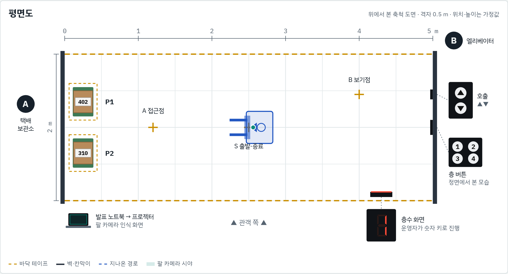
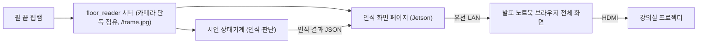
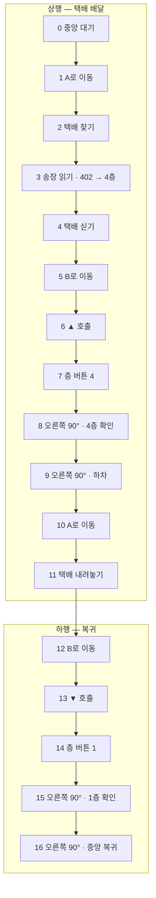
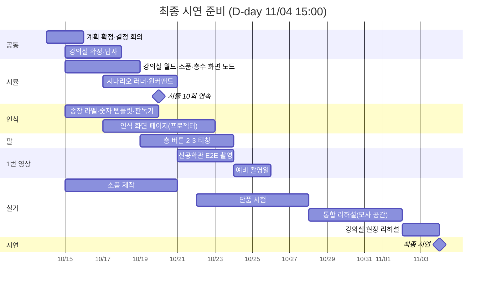

# 최종 시연 계획 — 강의실 시연 (2026-11-04 15:00)

> 상태: 🔄 계획 확정 전 · 작성: 2026-10-14 · 개정: 2026-10-14 (송장 층수 판독, 층 버튼, 프로젝터 인식 화면 추가) · 시연: 2026-11-04(수) 15:00, D-21
> 담당(제안): Lee — 시뮬·통합·주행·인식 화면 / Han — 구동부·리프트 / Kim — 로봇팔·버튼 누르기
> 위치·높이 값은 모두 [가정값]이다. 시뮬과 강의실 답사 뒤 이 문서에서 고친다.

## 1. 바뀐 점과 준비물

최종 시연 장소가 신공학관이 아니라 **일반 강의실**로 정해졌다. 그래서 시연은 두 가지로 나눈다.

| 번호 | 준비물 | 내용 | 상태 |
|---|---|---|---|
| 1 | 신공학관 E2E 무편집 영상 | 택배 집기 → 엘리베이터 → 배달 → 복귀 전 과정을 컷 없이 한 번에 촬영 | 지금까지 준비한 스택으로 촬영만 남음 |
| 2 | 강의실 현장 시연 | 택배 싣기·내리기, 송장 층수 판독, 엘리베이터 버튼 누르기, 층수 화면 인식 | 이 문서의 주 대상 |

2번은 실제 엘리베이터가 없으므로 강의실 안 5 × 2 m 구역에 **택배 보관소(A)**와 **엘리베이터(B)**를 꾸며 재현한다. 로봇 팔 카메라 화면을 노트북에 띄우고 프로젝터로 송출해, 로봇이 실제로 카메라로 인식하고 누른다는 것을 관객이 함께 본다. 시연 전에 같은 구역을 Gazebo 시뮬로 먼저 만들어 검증한다.

## 2. 강의실 세팅



### 좌표계

- 원점은 A쪽 아래 모서리. x축은 A → B(왼쪽 → 오른쪽), y축은 관객 쪽에서 안쪽 방향이다.
- 구역은 x 0~5 m, y 0~2 m. 가운데 선은 y = 1.0 m.
- 관객은 y < 0 쪽(그림 아래)에 앉는다. A가 관객 기준 왼쪽, B가 오른쪽이다.

### 배치표

| 항목 | 위치 (x, y) m | 크기·높이 | 비고 |
|---|---|---|---|
| 시연 구역 | x 0~5, y 0~2 | 5 × 2 m | 바닥 테이프로 외곽 표시 |
| A 끝벽 | x = 0 | 칸막이 또는 벽 | 택배 보관소 |
| B 끝벽 | x = 5 | 칸막이 또는 벽 | 버튼판 2장 부착 |
| 출발·종료점 S | (2.5, 1.0) | — | 시작 방향은 A쪽 |
| 택배 P1 | 팔레트 중심 (0.25, 1.35) | 팔레트 0.28 × 0.40 m, 택배 0.26 × 0.30 × 0.20 m | 송장 402(예시). 로봇 기준 오른쪽이라 기존 규칙상 이 택배를 집는다 |
| 택배 P2 | 팔레트 중심 (0.25, 0.65) | 같음 | 송장 310(예시). 그대로 남는 택배 |
| A 접근점 | (1.2, 1.0), A벽을 봄 | — | 팔레트가 0.95 m 앞. 회전 없이 바로 훑기 |
| B 보기점 | (4.0, 1.45), B벽을 봄 | 호출 버튼판 1 m 앞 | |
| 호출 버튼판 (▲▼) | B벽 (5.0, 1.45) | 13.5 × 20.5 cm. ▲ 0.68 m, ▼ 0.60 m | 기존 승하차판 |
| 층 버튼판 (1 2 / 3 4) | B벽 (5.0, 1.0) | 20.5 × 16 cm. 윗줄 1·2 0.68 m, 아랫줄 3·4 0.60 m | 기존 층 버튼판 |
| 층수 화면 | (4.3, 0.1), 로봇 쪽을 향함 | 화면 중심 높이 = 층수 보기 자세(`floor_view`) 카메라 시선 높이 (시뮬 가정 1.13 m) | 층 버튼을 누른 뒤 오른쪽 90° 돌면 약 0.9 m 정면 |
| 발표 노트북 | 구역 밖 관객 쪽 | — | 팔 카메라 인식 화면을 띄우고 HDMI로 프로젝터 연결 |
| 층수 화면 운영자 | 층수 화면 옆, 구역 밖 | — | 로봇이 누른 층 숫자 키를 입력 |

로봇 외곽은 nav2 footprint 기준 0.36 × 0.44 m이고 지게팔 끝이 회전축 앞 0.26 m, 팔레트를 실으면 앞 끝이 0.36 m까지 나온다. 실은 채 제자리 회전해도 반경 약 0.45 m라 2 m 폭 안에서 여유 있게 돈다. 층수 화면 거치대는 B 회전 지점에서 0.8 m 이상 떨어뜨린다.

버튼은 윗줄(▲, 1, 2)이 0.68 m, 아랫줄(▼, 3, 4)이 0.60 m라 줄마다 누르기 자세가 다르다. 좌우 열은 차체 위치로 맞춘다. 현재 티칭된 층 버튼 자세는 **1과 4뿐**이다(`button_arm_test` 메뉴 6·7). 2xx·3xx 송장도 시연하려면 2·3 자세를 추가로 티칭해야 한다.

### 송장 층수 규칙

| 송장 번호 | 목표층 | 누를 층 버튼 |
|---|---|---|
| 2xx (예: 205) | 2층 | 2 |
| 3xx (예: 310) | 3층 | 3 |
| 4xx (예: 402) | 4층 | 4 |

- 목표층은 송장 세 자리 번호의 **첫 자리**다.
- 세 자리가 아니거나 첫 자리가 2~4가 아니면 판독 실패로 보고 정지한다. 이때 인식 화면에 사유를 띄운다.
- 같은 번호를 새 프레임 3개 연속으로 읽어야 확정한다.
- 복귀할 때 누르는 층은 송장과 상관없이 1층이다.
- 송장 라벨은 흰 바탕에 굵은 검은 숫자 세 자리로 만들고, 택배에서 로봇을 향하는 면에 붙인다. 숫자 0~9 템플릿을 그 글꼴로 등록한다(`floor_reader`·`button_arm_test`와 같은 템플릿 비교 방식).

### 층수 화면 동작

| 시점 | 화면 숫자 |
|---|---|
| 시작 | 1 |
| 상행 층 버튼을 누른 뒤 | 1 → … → 목표층 (층당 약 2 s), 목표층 유지 |
| 하행 1 버튼을 누른 뒤 | 목표층 → … → 1, 1 유지 |

- 운영자가 로봇이 누른 층 숫자 키를 입력하면 화면이 한 층씩 바뀐다. 엘리베이터 역할은 사람이 맡고, 로봇은 판독·누르기·층수 읽기를 맡는다.
- 숫자 글꼴·검은 배경은 `tools/floor_reader`에 등록한 템플릿과 같아야 한다 (`/test` 페이지 형식).

### 프로젝터 인식 화면

관객은 층수 화면의 뒷면을 보게 되므로, 로봇 팔 카메라가 보는 화면을 인식 결과와 함께 노트북에 띄우고 프로젝터로 송출한다.



- 웹캠은 한 프로세스만 연다(기존 규칙). `floor_reader` 서버가 카메라를 열고, 상태기계와 인식 화면은 `/frame.jpg`로 같은 영상을 받는다.
- 인식 화면에는 단계 이름과 함께 검출 상자, 송장 판독 결과(예: 402 → 4층), 목표 버튼, 층수 연속 확인 횟수를 겹쳐 그린다.
- Jetson과 노트북은 유선 LAN으로 직결한다. 인터넷이 필요 없다.
- 영상이 끊기면 인식 화면에 "영상 끊김"을 띄운다. 로봇 동작은 인식 화면과 무관하게 기존 안전 규칙을 따른다.
- 발표 노트북에서 인식 화면을 녹화해 예비 자료로 남긴다.

## 3. 시연 시나리오

운영자는 시작 명령을 한 번만 내린다. 이후 로봇은 사람 손 없이 끝까지 진행한다. 아래는 송장 402(목표 4층) 기준이다.

| # | 단계 | 로봇 동작 | 인식·센서 | 성공 조건 | 실제 엘리베이터에서의 의미 |
|---|---|---|---|---|---|
| 0 | 대기 | 중앙 S에서 A쪽을 보고 정지. 팔 접힘, 리프트 0 | — | 운영자 시작 명령 | 출발점 대기 |
| 1 | A로 이동 | S → A 접근점 | LiDAR | 접근점 도착 | 1층 택배 보관소로 이동 |
| 2 | 택배 찾기 | 지게팔 내림 → 좌·중·우로 훑기 → 가장 오른쪽 P1 선택 | 팔 카메라(택배) | 택배 검출, P1 선택 | 보관함에서 택배 찾기 |
| 3 | 송장 읽기 | P1 팔레트 0.85 m 앞에 정렬하며 송장 번호 판독 → 첫 자리로 목표층 결정 | 팔 카메라(송장 숫자) | 같은 번호 3프레임 연속, 첫 자리 2~4 | 배달할 층 확인 |
| 4 | 택배 싣기 | 다시 정렬 → 포켓 진입 → 들기 | 팔 카메라(팔레트 앞면), 초음파 | 택배 실음 | 택배 승차 |
| 5 | B로 이동 | A → B 보기점 | LiDAR | 도착 | 1층 승강장으로 이동 |
| 6 | ▲ 호출 | 호출 버튼판에서 ▲ 찾기 → 정렬점에서 다시 보기 → 접근 → 누르기 → 0.3 m 후진 → 다시 보기 | 팔 카메라(호출 버튼판) | ▲ 재인식·누름 위치 확인 | 엘리베이터 호출(위) |
| 7 | 4 누르기 | 층 버튼판 앞으로 비켜 섬 → 숫자 4 찾기 → 접근 → 누르기 → 후진 → 다시 보기 | 팔 카메라(층 버튼 숫자) | 4 재인식·누름 위치 확인 | 탑승 후 4층 선택 |
| 8 | 4층 확인 | 오른쪽 90°(층수 화면 정면) → `floor_view` 자세 → 대기 | 팔 카메라(층수 화면) | 숫자 4를 새 프레임 5개 연속 확인 | 4층 도착 확인 |
| 9 | 하차 | 팔 접기 → 오른쪽 90°(A쪽) | — | 회전 완료 | 4층 하차 |
| 10 | A로 이동 | → P1 원래 자리 앞 하역점 | LiDAR | 도착 | 4층 배달지로 이동 |
| 11 | 택배 내려놓기 | 리프트 0 → 해제 → 0.3 m 후진 | 리프트 위치 | P1 원래 자리 ±0.10 m | 배달 완료 |
| 12 | B로 이동 | → B 보기점 | LiDAR | 도착 | 4층 승강장으로 이동 |
| 13 | ▼ 호출 | 6번과 같음(빈 상태) | 팔 카메라(호출 버튼판) | ▼ 재인식·누름 위치 확인 | 엘리베이터 호출(아래) |
| 14 | 1 누르기 | 층 버튼판 앞으로 비켜 숫자 1 누름 | 팔 카메라(층 버튼 숫자) | 1 재인식·누름 위치 확인 | 1층 선택 |
| 15 | 1층 확인 | 오른쪽 90° → `floor_view` → 대기 | 팔 카메라(층수 화면) | 숫자 1을 새 프레임 5개 연속 확인 | 1층 도착 확인 |
| 16 | 하차·복귀 | 팔 접기 → 오른쪽 90° → 중앙 S로 이동 → 정지 | LiDAR | S ±0.15 m 도착 | 출발점 복귀, 종료 |

송장이 3xx면 7번은 3 누르기, 8번은 3층 확인이 된다. 2xx도 같은 방식이다. A는 처음에는 1층 택배 보관소, 두 번째 방문에서는 목표층 배달지 역할을 한다. 발표 때 이 점을 먼저 설명한다.



## 4. 시뮬레이션 계획

### 기반

`lee/sim-e2e-20261008` 브랜치의 `sim/real_maps`를 바탕으로 한다. 격리 컨테이너, 공용 상태기계와 시뮬 어댑터(`sim_adapters.py`), 장식·버튼·층 표시창 모델(`dressing.py`, 층 버튼판·승하차판 치수 포함), 팔레트·택배 mock(`parcel_mock.py`), 카메라 인식(`perception.py`)이 이미 있다. 작업 브랜치는 `lee/demo-20261104`, 시연 자료는 모두 `demo_20261104/` 폴더에 둔다.

### 기존 코드 재사용

| 시나리오 동작 | 재사용 코드 | 강의실용 변경 |
|---|---|---|
| 택배 찾기·싣기 (2, 4) | `skilltests/parcel_pickup.py` | 도착 후 "오른쪽 90°" 단계를 설정으로 끌 수 있게 한다(현장 기본값은 그대로). 강의실은 A벽을 보고 도착하므로 회전이 필요 없다 |
| 송장 읽기 (3) | `button_arm_test/vision.py`의 숫자 템플릿 비교 | 새로 만듦: 흰 라벨 검출 → 세 글자 분리 → 숫자별 템플릿 비교 → 첫 자리로 목표층. 정렬(0.85 m 앞) 중에 판독 |
| 호출·층 버튼 누르기 (6, 7, 13, 14) | `skilltests/button.py`, `button_arm_test`의 숫자·▲▼ 판정, 누르기 자세(1·4·▲·▼) | 층 버튼 목표를 송장 판독 결과로 받음. 2·3 누르기 자세 추가 티칭 |
| 층수 확인 (8, 15) | `elevator_ride.confirm_floor`, `tools/floor_reader` | 목표층을 송장 판독 결과로 받음. 지도 전환·문 열림 확인 제외 |
| 오른쪽 90° 회전 | `skilltests/control.py` `turn_by` | 없음 |
| 택배 내려놓기 (11) | `run_e2e.py` `unload_autonomous` (내림 → 해제 → 후진) | 시뮬 러너 함수를 공용 상태기계 `parcel_dropoff`로 옮겨 Jetson에서도 같은 코드 사용 |
| A↔B 주행 | Nav2 + 강의실 지도, 또는 `control.py` odom 직선 주행 | `--nav map/odom` 전환 옵션 |

### 새로 만들 것

1. **강의실 월드** — 5 × 2 m 바닥, A·B 끝벽, 측면은 개방(책상 다리 몇 개로 LiDAR 환경 모사). 지도는 월드 치수에서 바로 생성한다(SLAM 불필요).
2. **소품 배치** — A에 팔레트+택배 2개(송장 숫자 텍스처), B벽에 호출 버튼판과 층 버튼판, B 오른쪽에 층수 화면.
3. **층수 화면 노드** — 팔 끝이 층 버튼 캡에 닿으면(기존 `elevator_sim_node` 판정 방식) 그 층까지 한 층씩 숫자를 바꾼다. 실물의 운영자 키 역할이다.
4. **송장 판독기** — 시뮬 카메라 영상과 실물 웹캠에 같은 코드를 쓴다.
5. **강의실 B 상태기계** `classroom_elevator` — 호출 버튼 + 층 버튼 + 오른쪽 90° + 층수 확인 + 오른쪽 90°. 문·지도 전환은 없다.
6. **인식 화면 페이지** — 시뮬에서는 `/arm_camera/image_raw`, 실물에서는 `/frame.jpg`를 받아 같은 화면을 그린다. 시뮬로 프로젝터 화면을 먼저 리허설한다.
7. **시나리오 러너** `run_classroom_demo.py` — 원커맨드로 빌드 → 기동 → 0~16단계 → 판정 → 로그 저장 → 정리까지 한다.

```bash
python3 demo_20261104/sim/run_classroom_demo.py --gui --speed 3 --repeats 10
python3 demo_20261104/sim/run_classroom_demo.py --label 310            # 3층 송장으로 실행
python3 demo_20261104/sim/run_classroom_demo.py --from 12              # 12단계(하행)부터 다시 시작
```

### 판정 항목

- 단계별 성공·실패와 소요 시간, 총 소요 시간
- 송장 판독 값 = 배치한 송장 번호, 누른 층 버튼 = 송장 첫 자리, 층수 확인 값 = 목표층
- 택배 원래 자리 오차 (기준 0.10 m), 종료점 오차 (기준 0.15 m)
- 최소 벽 거리 (주행 0.15 m, 스킬 단계 0.05 m — 기존 E2E 기준과 같음)

### 완료 기준

- 원커맨드 10회 연속 완주 (송장 2xx·3xx·4xx 섞어서)
- 발표 예비용 GUI 녹화 1개

## 5. 실기 준비

### 소품 체크리스트

- [ ] 바닥 테이프: 구역 외곽, S, A 접근점, P1·P2 팔레트 자리, B 보기점
- [ ] A: 팔레트 2개 + 택배 2개 + 송장 라벨(2xx·3xx·4xx 각 1장 이상, 예비 포함)
- [ ] B: 끝벽(칸막이) + 호출 버튼판(▲▼) + 층 버튼판(1~4), 높이는 누르기 자세에 맞춤
- [ ] 층수 화면: 노트북 또는 모니터 + 거치대, 숫자 키로 진행하는 페이지
- [ ] 인식 화면: 발표 노트북, 유선 LAN 케이블, HDMI 케이블·변환 어댑터, 강의실 프로젝터 입력 확인
- [ ] 정지 수단: 소프트 정지 키 + 전원 차단 담당자 1명

### 단품 시험 (강의실 모사 공간)

연구실 등에 같은 5 × 2 m 구역을 테이프로 만들고 `tools/jetson_skill_tests/run_test.py` 방식으로 하나씩 시험한다.

| 시험 | 횟수 |
|---|---|
| 택배 찾기·싣기 (P1) | 5회 연속 |
| 송장 판독 2xx / 3xx / 4xx | 각 5회 연속 |
| ▲ / ▼ 누르기 | 각 5회 연속 |
| 층 버튼 1 / 2 / 3 / 4 누르기 | 각 5회 연속 (2·3은 티칭 뒤) |
| 층수 확인 1 / 2 / 3 / 4 | 각 5회 연속 |
| 택배 내려놓기 | 5회 연속 |
| 인식 화면 프로젝터 송출 | 30분 연속 끊김 없음 |

### 통합 리허설

- 강의실 모사 공간에서 전체 시나리오 3회 연속 무개입 완주
- 실제 강의실에서 2회 완주 (11/02~11/03), 프로젝터 송출 포함
- 실제 강의실에서 주행 방식(지도 기반 Nav2 / odom 직선)을 정한다

## 6. 1번 영상 — 신공학관 E2E 무편집

| 항목 | 계획 |
|---|---|
| 내용 | 출발 → 택배 집기 → 엘리베이터 탑승 → 목표층 배달 → 엘리베이터 → 복귀를 한 테이크로 |
| 촬영일 | 10/21~10/23, 예비 10/24~10/25 |
| 확보 목표 | 무편집 원본 1개 + 예비 1개 |
| 촬영 방식 | 로봇을 따라가는 카메라 1대. 인식 화면도 동시에 녹화해 화면 속 화면으로 합성(컷 없음) |
| 사전 확인 | 배터리 완충, 엘리베이터 붐비지 않는 시간대, 통행 안내 1명, 화면에 시각 표시 |
| 보관 | 원본은 로컬 보관. 대용량 영상은 저장소에 커밋하지 않는다 (AGENTS.md 규칙 14) |

## 7. 일정



| 기간 | 할 일 | 완료 기준 |
|---|---|---|
| 10/14(수)~10/20(화) | 계획 확정, 강의실 답사, 시뮬 구축, 송장 판독기, 소품 제작 | 시뮬 10회 연속 완주 |
| 10/21(수)~10/27(화) | 1번 영상 촬영, 인식 화면 완성, 2·3 티칭, 실기 단품 시험 | 영상 원본 확보, 단품 전 항목 통과 |
| 10/28(수)~11/03(화) | 통합 리허설, 강의실 현장 리허설(프로젝터 포함) | 모사 공간 3회 연속, 강의실 2회 완주 |
| 11/04(수) | 시연 | — |

### 시연 당일

| 시각 | 할 일 |
|---|---|
| 12:30 | 장비 반입, 바닥 테이프 확인 |
| 13:00 | 소품 설치, 프로젝터 연결, 층수 화면·송장 템플릿 확인 |
| 13:30 | 로봇 기동, 위치 초기화, 단품 점검 |
| 14:00 | 전체 리허설 1회 |
| 14:30 | 충전·원위치, 송장 라벨 확인, 대기 |
| 15:00 | 시연 |

강의실을 몇 시부터 쓸 수 있는지 먼저 확인한다.

## 8. 리스크와 대응

| 리스크 | 영향 | 대응 |
|---|---|---|
| 송장 오판독 | 다른 층 버튼을 누름 | 3프레임 연속 일치 + 첫 자리 2~4 범위 검사, 실패 시 정지. 라벨 글꼴 고정·글자 크게 |
| 층 버튼 2·3 자세 미티칭 | 2xx·3xx 송장 시연 불가 | Kim 티칭 일정 확보. 늦어지면 시연 송장을 4xx로 고정 |
| 카메라 동시 점유 | 인식 화면과 상태기계가 서로 카메라를 뺏음 | `floor_reader` 서버 하나만 카메라를 열고 나머지는 `/frame.jpg` 사용 |
| 프로젝터 송출 끊김·지연 | 관객이 인식 과정을 못 봄 | 유선 직결, 사전 30분 연속 시험, 노트북 화면 녹화 예비 |
| 강의실 바닥·조명을 아직 모름 | 미끄러짐, 숫자 오인식 | 사전 답사, 현장 조명에서 템플릿 재등록, 화면 밝기 최대·반사 각도 조정 |
| 측면이 열려 있음(관객·책상) | LiDAR 위치 추정 흔들림 | A·B 끝벽 기준 정렬, odom 직선 주행 예비 모드 |
| 실물 버튼(종이컵)에는 램프가 없음 | 누름 확인 근거가 약함 | 후진 후 카메라 재확인 + 층수 화면 변화로 이중 확인 |
| 팔레트 포켓 진입 실패 | 집기 실패 | 바닥 테이프로 자리 고정, 1회 재시도, 실패 시 운영자가 재배치하고 해당 단계부터 재시작 |
| 소프트·물리 E-stop 미구현 (Roadmap 08) | 관객 안전 | 정지 키 + 전원 차단 담당자 지정. 시연 전 필수 |
| 배터리 | 시연 중 정지 | 완충, 예비 배터리, 리허설 뒤 재충전 |
| 시연 시간 초과 | 발표 시간 부족 | 시뮬·실기 소요 시간을 재고 대기·속도를 줄임 |
| 시연 중 한 단계 실패 | 시연 중단 | `--from <단계>` 재시작 절차를 연습해 둠 |

## 9. 결정 필요 항목

| # | 항목 | 기본안 | 결정 |
|---|---|---|---|
| 1 | 송장 라벨 규격 | 흰 바탕 검은 굵은 숫자 3자리, 글자 높이 4 cm 이상, 택배 앞면 | |
| 2 | 시연 송장 번호 | P1 402, P2 310 | |
| 3 | 버튼판 배치 | 호출 버튼판 y 1.45 m, 층 버튼판 y 1.0 m (둘 다 B벽) | |
| 4 | 층 버튼 2·3 티칭 | 티칭해서 2xx·3xx도 시연. 늦어지면 4xx 고정 | |
| 5 | 층수 화면 진행 | 운영자가 로봇이 누른 층 숫자 키 입력 | |
| 6 | 인식 화면 연결 | Jetson–노트북 유선 LAN 직결 | |
| 7 | 집을 택배 선택 | 기존 규칙(로봇 기준 가장 오른쪽 = P1) 유지 | |
| 8 | 주행 방식 | 강의실 리허설에서 지도 기반 Nav2와 odom 직선 중 선택 | |
| 9 | 강의실과 사용 가능 시간 | 답사 일정과 당일 반입 시각 확인 | |
| 10 | 1번 영상 배속 | 무편집 원본은 1배속, 발표용은 배속본 별도 | |

## 10. 완료 기준 요약

- 시뮬: 원커맨드 10회 연속 완주 (송장 2xx·3xx·4xx)
- 실기 단품: 전 항목 각 5회 연속 성공, 인식 화면 30분 연속 송출
- 실기 통합: 모사 공간 3회 연속, 실제 강의실 2회 완주
- 1번 영상: 무편집 원본 1개 + 예비 1개
