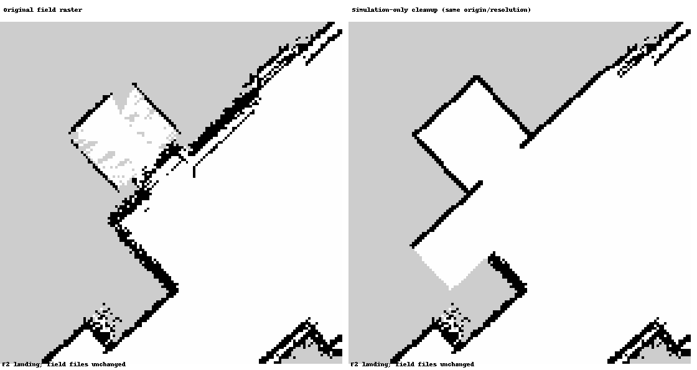

# E2E 수정·검증 보고서 — 2026-10-14

> 전체 왕복 r10은 완주·시뮬 안전 기준 통과. 후속 실패를 보완했지만 최신 코드 전체 완주는 아직 재확인하지 않았다. 사용자 요청으로 장시간 반복 검증은 종료했다.
> 시뮬레이션 결과다. 원본 Claude 체크아웃·현장 원본 지도는 유지했다. 이 독립 체크아웃의 공용 팔 명령 코드는 사용자 지시대로 정면 고정으로 수정했다.

## 실행 결과

| 실행 | 왕복 | 안전 판정 | 기록 | 비고 |
|---|---|---|---|---|
| r9 | 실패 | 완주 미달 | 정상 | 배달·하역·F2 재탑승까지 성공, 1번 점등의 예측 픽셀 불일치로 중단 |
| r10 | 완료 | 통과 | DB 잠금 충돌, 메타데이터 복구 | 요청 캡 영상 재확인·정면 누름·누름 위치 저장·F1 복귀 확인 |
| r11 | 실패 | 완주 미달 | 정상 | 위치 전환 실패 뒤 ROS 변환 예외로 시뮬 노드 종료 |
| r12 | 실패 | 완주 미달 | 정상 | 호출 버튼 정렬 오차로 누르기 전에 중단 |
| r13 복귀만 | 실패 | 완주 미달 | 계약 미달 | 버튼·실제 F1 이동 확인, 회전 중 전환으로 상대 자세 검사 실패 |
| r14 복귀만 | 실패 | 미달 | 계약 미달 | 버튼·소등·실제 F1 이동·재정위 확인, 하차 중 문이 닫혀 정지 |

r10은 시뮬 시간 1,769.9 s, 준비를 포함한 실제 시간 633.8 s였다. Nav2 구간 최소 벽 거리 0.3076 m, skill 구간 0.1246 m. 기준은 각각 0.15 m, 0.05 m이며 낮추지 않았다. 최대 배속 실행은 기존 1배속 통계와 분리한다.

검사: 상태기계·영상·기억 시험 73개, 팔 명령/보간 및 실행 계약 검사 통과. 시뮬 검사 묶음 9개, 이식성 217개 파일 검사 통과.

## 반영한 동작

- F2 문 주변 잡음 띠만 정리했다. 변경 1,571셀, 지정 영역 밖 변경 0셀. 물리 벽은 평면 5개, Nav2는 같은 기하를 래스터화한 전용 지도다. 경계 근사 최대 0.0354 m. 호출판은 두 층 모두 오른쪽이다. 정리된 F2에는 울퉁불퉁한 래스터 시각 장식을 덮지 않는다.
- 빈 포크·적재 팔레트까지 Nav2/평가 외곽에 포함한다. 적재 후 먼저 0.30 m 곧게 후진하고 Nav2가 회전한다. local/global costmap 외곽을 적재 상태에 맞춰 갱신한다.
- 추가 카메라는 없다. 기존 팔 끝 카메라의 현재 버튼판에서 요청 라벨의 캡을 다시 찾고, 그 캡의 점등만 누름 근거로 사용한다. 다른 버튼·층 표시창은 누름 근거가 아니다. 층 표시창은 도착 층 확인에만 사용한다.
- 팔 받침 yaw와 손목 roll은 1500 PWM 정면 고정이다. 어깨·팔꿈치 위아래 각도만 바꾸고 차체는 버튼판을 정면으로 바라본다. 도착 판정 정밀도를 높였고 작은 차체 방향 오차를 최대 2회 보정한다. 오른쪽 팔의 옆 오프셋은 차체 위치로 맞춘다. 맞춤 서보 명령에서도 회전 자세를 거부한다.
- 목적층 도착 시 해당 층 버튼 램프를 끈다. 호출도 요청 처리 시 소등한다. 이미 열린 현재층에서 호출해도 램프가 계속 남지 않도록 처리했다.
- 성공한 버튼만 층·종류·라벨별로 기억한다. 버튼 map 좌표, 누름 순간 차체 추정 위치/방향, 팔 PWM을 저장한다. 좌표는 카메라·LiDAR 관측과 encoder odom/TF로 계산한 로봇 추정값이며 시뮬 참값이 아니다. 다음 실행에서는 prior로 참고하지만 현재 카메라 재확인은 생략하지 않는다. 지도·팔 설정 변경 시 기억은 무효다. r10에서 F1/UP·F1/2·F2/DOWN·F2/1 저장 확인.
- 층 이동은 서비스 성공 응답과 목적층 위치 4회 연속 확인 후 도착을 발행한다. 관절 hold는 이동 전체가 아닌 위치 전환 직전 3 s부터 중지하고, 팔이 쓰기 중단을 확인한 뒤 1 s 안정화 후 전환한다. 차체 이동·회전도 정지한 뒤에만 전환 목표를 저장한다. 자세 보존 검사는 비동기 요청 시각 대신 이동 확인 시각을 사용한다. 캐빈 중앙 5 cm 안에서 불필요하게 크게 돌아가지 않도록 복귀 방향을 자동 선택한다.
- r14의 하차 실패 뒤 문 막힘 감지·캐빈 내부 판정에도 포크/적재 짐 외곽을 반영했다. 이 마지막 보완은 단위 검사까지 통과했고 시뮬 재실행은 생략했다.
- 정리된 시뮬 지도는 실행별 경로·YAML/PGM 해시를 고정하고, 목표 전달 전에 실제 map_server와 로드한 경로까지 검사한다. 현장 지도 검사는 유지한다.



## 녹화·재현

독립 체크아웃: `cs_sim_e2e_codex_20261013`, 브랜치 `lee/sim-e2e-20261008`.

```bash
cd /home/hsm/2026_graduation_project/cs_sim_e2e_codex_20261013
SIM_GUI=1 SIM_SPEED=max bash sim/real_maps/run_codex_validation.sh --start-stage full
```

필요 시 빌드 → 월드 생성 → 검사 → 화면 왕복 → 로그 → 정리를 한 명령으로 수행한다. `SIM_SPEED=max`는 물리 step 1 ms를 유지하고 배속 제한을 해제한다. CPU/렌더링 부하에 따라 실제 배속은 달라진다.

```bash
# F1 캐빈에서 짐을 실은 초기 조건부터 배달·복귀만
SIM_GUI=1 SIM_SPEED=max bash sim/real_maps/run_codex_validation.sh --start-stage cabin
# 문제였던 F2 내부부터 F1 하차·출발점 복귀만
SIM_GUI=1 SIM_SPEED=max bash sim/real_maps/run_codex_validation.sh --start-stage return
# 화면 없이 전체 실행. 팔 카메라 렌더링용 X11 연결은 유지
SIM_GUI=0 SIM_SPEED=max bash sim/real_maps/run_codex_validation.sh --start-stage full
```

로그: `logs/real_map_sim/<실행 이름>/result.json`, 판정 영상: 같은 폴더의 `camera_*.png`. 기억: `logs/button_press_memory/sim.json`, 실행별 사본: `button_press_memory.json`. 실행 중 rosbag SQLite DB는 열지 않고, 기록이 종료된 뒤 읽는다.

## 적용 범위

시뮬 제안 시간은 호출 응답 20 s·층간 이동 45 s·열림 유지 60 s다. 기존 팔 카메라로 누르고 물러나 요청 버튼을 확인하는 순서를 검증하기 위한 값이며 현장 실측값이 아니다. 실물 종이컵에는 램프가 없다는 사용자 설명을 유지한다. 실물 눌림·하중·PWM 영점·링크 길이·실제 엘리베이터 타이밍은 별도 실측이 필요하다.

캐빈 시작 모드는 수거·F1 호출/입장 이전 동작을 검증하지 않는다. `return` 모드는 F2→F1 복귀만 검증한다. 최신 전체 E2E의 녹화 안정성은 미확정이며, 다음 확인은 최종 코드 전체 왕복 한 번이다. 완주와 안전 판정, 기록 상태를 각각 확인한다.
